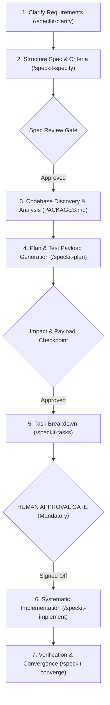

## User Input

```text
$ARGUMENTS
```

You **MUST** consider the user input before proceeding (if not empty).

## Purpose & Scope

This skill enforces the repository-specific engineering workflow for `python_code_samples_network`. Whenever a feature request, bug fix, or scenario modification is requested in this repository, follow this structured, multi-phase lifecycle without skipping steps:



---

## The 7-Stage Execution Sequence

### Stage 1: Understand & Clarify Requirements
- Do not immediately start editing files or writing solutions.
- Parse the user's intent, identify underspecified areas, assumptions, target network platforms (Cisco IOS-XE, Cisco NSO, APIC-EM, ACI), and protocol versions.
- Ask up to 5 clear, targeted clarification questions to remove ambiguities.
- Use `/speckit-clarify` to record answers.

### Stage 2: Structure Specification & Acceptance Criteria
- Run `/speckit-specify` to draft `specs/<feature>/spec.md`.
- Detail user stories, functional requirements, and strict acceptance criteria.
- Validate that secrets and credentials conform to the zero-hardcoded-secrets policy (Constitution Principle II).
- Pause for spec review before touching code.

### Stage 3: Codebase Discovery & Architectural Analysis
- Review [PACKAGES.md](./PACKAGES.md) to discover which packages, sample scripts, or central modules are involved:
  - Is this a standalone sample (`RESTCONF/`, `NC-get-config/`, `model-based-aaa/`, etc.)?
  - Does it touch the centralized NSO client (`nso_client.py`, `nso_scenarios.py`)?
- Analyze existing YANG models (`Cisco-IOS-XE-native`, `tailf-ncs:devices`, `ietf-netconf-acm`) and HTTP/RPC endpoints.
- Map out the blast radius and potential regressions.

### Stage 4: Technical Planning & Test Payload Generation
- Run `/speckit-plan` to generate `specs/<feature>/plan.md`.
- In addition to standard architecture, the plan **MUST** include:
  1. **Network Impact Matrix**: Touched files, target devices, and blast radius.
  2. **Network Test Strategy**: Offline mock test suite (`pytest` with mocked `requests`/`ncclient`/`netmiko`) to allow verification in CI without physical hardware.
  3. **Generated Network Test Payloads**: Exact JSON payloads for RESTCONF, XML filters for NETCONF, or CLI strings for Netmiko, along with expected HTTP status codes (200/201/204) or RPC responses (`<ok/>`).
  4. **Rollback & Safety Plan**: How configuration can be reverted if the network device rejects changes.

### Stage 5: Impacted Components & Payload Checkpoint
- Present the planned code diffs, impacted packages, and generated payloads to the user.
- Verify that request timeouts and error handling comply with Constitution Principle IV.

### Stage 6: Human Approval Gate (MANDATORY)
- **CRITICAL GATE**: The human engineer must review and explicitly approve:
  - The planned code changes
  - The generated network test payloads
  - The test approach and rollback plan
- Never begin code implementation without human consent.

### Stage 7: Task Breakdown, Implementation & Convergence
- Run `/speckit-tasks` to generate ordered work items (`tasks.md`).
- Run `/speckit-implement` to execute code changes step-by-step against offline mock tests.
- Run `/speckit-converge` to verify that all acceptance criteria are met, lint checks (`ruff check .`) pass, and offline unit tests pass (`pytest tests/`).
