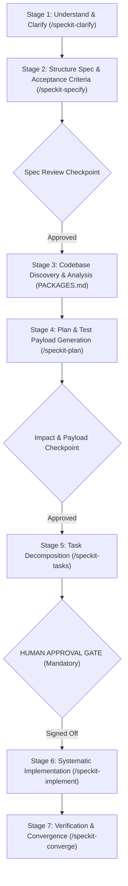

# Agent & Developer Guidelines: Python Code Samples Network

This repository contains network programmability and automation code samples across Cisco technologies (RESTCONF, NETCONF, Cisco IOS-XE, Cisco NSO, Netmiko, SNMP, EEM, APIC-EM, and Cisco ACI).

This project is configured for **Spec-Driven Development (SDD)** using **GitHub Spec Kit** with multi-agent integrations for **Antigravity (`agy`)** and **Claude Code (`claude`)**.

---

## 1. Repository Architecture & Package Catalog

Before modifying or implementing any network scripts, agents **MUST** inspect the repository package catalog:
- **Location**: [`PACKAGES.md`](./PACKAGES.md)
- **Contents**: Full technical documentation of all 20 packages and the centralized Cisco NSO framework, including target devices, protocols, YANG data models, CLI parameters, and execution instructions.

---

## 2. Repository-Specific SDD Workflow (`network-sdd`)

Whenever changes, enhancements, or bug fixes are submitted to this repository, agents MUST adhere to the **Network Engineering SDD Workflow**:



### The 7-Stage Engineering Pipeline

1. **Stage 1: Understand & Clarify Requirements (`/speckit-clarify`)**:
   - Understand the problem scope, target network devices, controllers, and protocol versions.
   - Ask up to 5 clear, targeted clarification questions before drafting specifications.
2. **Stage 2: Structure Specification & Acceptance Criteria (`/speckit-specify`)**:
   - Generate `specs/<feature>/spec.md` with explicit user stories and measurable acceptance criteria.
   - Ensure strict compliance with the zero-hardcoded-secrets policy (Constitution Principle II).
3. **Stage 3: Codebase Discovery & Architectural Analysis**:
   - Consult [`PACKAGES.md`](./PACKAGES.md) to discover affected sample directories and modules.
   - Inspect existing YANG models (`Cisco-IOS-XE-native`, `tailf-ncs:devices`, `ietf-netconf-acm`) and API endpoints.
   - Assess blast radius and regression risks (`/speckit-analyze`).
4. **Stage 4: Technical Planning & Test Payload Generation (`/speckit-plan`)**:
   - Generate `specs/<feature>/plan.md` using the updated plan template.
   - **MANDATORY**: Formulate the network test approach and generate exact test payloads:
     - RESTCONF JSON / YANG payloads with expected HTTP status codes (200/201/204).
     - NETCONF XML subtree/XPATH filters with expected RPC responses.
     - CLI command sequences with expected prompt outputs.
     - Rollback and safety mitigation plans.
5. **Stage 5: Impact Review & Checkpoint**:
   - Review proposed code diffs, touched files, and test payloads against Constitution principles.
6. **Stage 6: Human Approval Gate (MANDATORY & NON-NEGOTIABLE)**:
   - Present the implementation plan, blast radius, and generated test payloads to the human engineer.
   - **Code implementation MUST NOT begin until the human engineer reviews and explicitly signs off.**
7. **Stage 7: Task Breakdown, Implementation & Convergence**:
   - Generate ordered tasks via `/speckit-tasks`.
   - Implement step-by-step against offline mock tests via `/speckit-implement`.
   - Verify codebase convergence, test passing, and lint status via `/speckit-converge`.

### Available Skills in Integrations (`.agents/skills/` & `.claude/skills/`)
- **`/speckit-network-workflow`**: Execute or audit the complete repository-tailored 7-stage engineering pipeline.
- **`/speckit-constitution`**: Establish, audit, or amend the project constitution and core principles.
- **`/speckit-specify`**: Create baseline specifications (`spec.md`).
- **`/speckit-clarify`**: Ask clarification questions to de-risk requirements.
- **`/speckit-plan`**: Create technical blueprints with test payloads and impact analysis.
- **`/speckit-checklist`**: Generate requirements validation checklists.
- **`/speckit-tasks`**: Generate dependency-ordered, test-first task lists.
- **`/speckit-implement`**: Execute tasks against offline tests.
- **`/speckit-converge`**: Assess codebase convergence and append remaining tasks.
- **`/speckit-analyze`**: Cross-artifact consistency analysis.

---

## 3. Dev Environment & Setup

- **Python Version**: Python 3.9+ (Python 3.12 / 3.14 compatible).
- **Virtual Environment**:
  ```bash
  python3 -m venv .venv
  source .venv/bin/activate
  python -m pip install -U pip
  ```
- **Modern uv Workflow**:
  ```bash
  uv sync
  uv run python -m unittest tests/test_nso.py
  ```
- **Standalone Sample Folders**: Each network sample directory is self-contained. Navigate to the folder, read its `README.md`, install dependencies, and run:
  ```bash
  cd <sample-folder>
  [ -f requirements.txt ] && python -m pip install -r requirements.txt
  python <script>.py
  ```
- **Common Packages**: `requests`, `ncclient`, `netmiko`, `pysnmp`, `pytest`.

---

## 4. Secrets & Device Configuration (NON-NEGOTIABLE)

**Never commit real credentials, passwords, tokens, or private endpoints.**

- Scripts must prioritize configuration via environment variables:
  - `RESTCONF_HOST` / `NSO_HOST`
  - `RESTCONF_USER` / `NSO_USER`
  - `RESTCONF_PASSWORD` / `DEVNET_RESTCONF_PASSWORD` / `NSO_PASSWORD`
  - `RESTCONF_DEVICE` (default: `dist-rtr00`)
- If credentials are not present in the environment, scripts must prompt securely via `getpass()`.
- Default values must only point to public Cisco DevNet sandboxes.
- Never commit `.env` or personal credential files.

---

## 5. Testing & Quality Verification

- **Offline Unit & Mock Tests**:
  Network scripts should include unit tests with mocked responses (e.g. `unittest.mock` or `pytest-mock` for HTTP/RESTCONF and NETCONF calls) to allow verification without physical hardware:
  ```bash
  uv run python -m unittest discover tests
  ```
- **DevNet Sandbox Smoke Tests**:
  Test against live devices using Cisco DevNet Sandbox:
  - https://devnetsandbox.cisco.com/DevNet
  - Cisco API Docs: https://developer.cisco.com/docs/
- **Static Checks & Linting**:
  ```bash
  ruff check .
  mypy --ignore-missing-imports .
  ```

---

## 6. Contribution & PR Instructions

- **PR Title Format**: `[sample-folder] <Short description>` (e.g. `[RESTCONF] support NSO device targeting`).
- **Scope**: Keep changes limited to one sample folder or one self-contained capability whenever possible.
- **Pre-Commit Checklist**:
  - Run modified scripts and automated unit tests.
  - Update folder `requirements.txt` if dependencies changed.
  - Update `README.md` within the affected folder and verify [`PACKAGES.md`](./PACKAGES.md).
  - Run `ruff check .` to ensure clean code style.
  - Verify no passwords, tokens, or internal IP addresses are committed.
