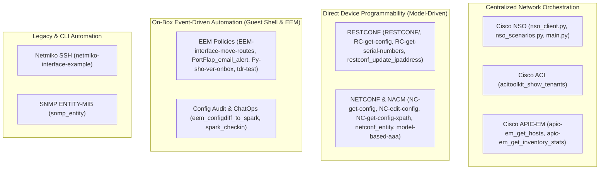
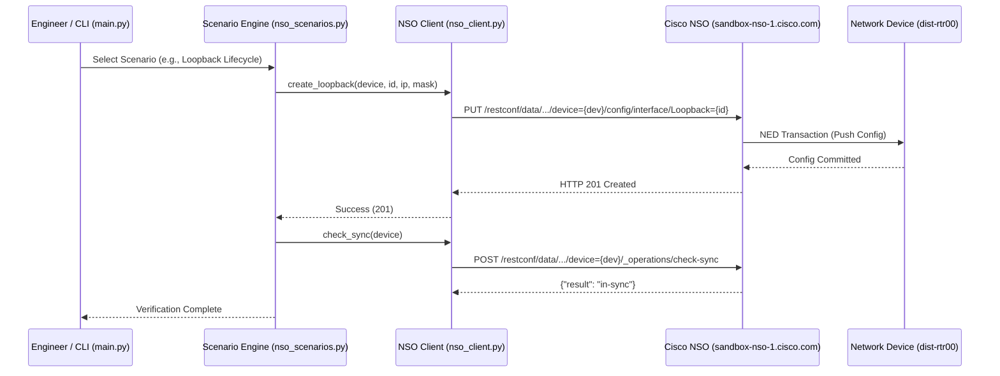

# Repository Package Catalog & Architecture Guide

This document provides a comprehensive architectural breakdown of every sample package, script, and component in the `python_code_samples_network` repository. It explains **why each package exists**, **how it works**, its **target network devices**, **protocols**, **YANG models/APIs**, **parameters**, and **execution guidelines**.

---

## 1. Architectural Overview & Technology Matrix

The repository showcases network programmability and automation across the entire spectrum of Cisco network operating systems, controllers, and protocols:



### Protocol & Technology Capability Matrix

| Package Directory | Primary Protocol | Target Device / Controller | Key YANG Model / API / MIB | Execution Location |
|---|---|---|---|---|
| `RESTCONF/` | RESTCONF (RFC 8040) | Cisco IOS-XE / Cisco NSO | `Cisco-IOS-XE-native`, `tailf-ncs:devices` | Off-box |
| `RC-get-config/` | RESTCONF (RFC 8040) | Cisco IOS-XE / Cisco NSO | `Cisco-IOS-XE-native:native` | Off-box |
| `RC-get-serial-numbers/` | RESTCONF (RFC 8040) | Cisco IOS-XE | `Cisco-IOS-XE-device-hardware-oper` | Off-box |
| `restconf_update_ipaddress/` | RESTCONF (RFC 8040) | Cisco IOS-XE / CSR1000v | `ietf-interfaces:interfaces` | Off-box |
| `NC-get-config/` | NETCONF (RFC 6241) | Cisco IOS-XE (Cat9300) | Full Running Config XML | Off-box |
| `NC-get-config-xpath/` | NETCONF (RFC 6241) | Cisco IOS-XE | XPATH `/native/interface/Loopback` | Off-box |
| `NC-edit-config/` | NETCONF (RFC 6241) | Cisco IOS-XE | `Cisco-IOS-XE-native:native/hostname` | Off-box |
| `netconf_entity/` | NETCONF (RFC 6241) | Cisco IOS-XE | `ENTITY-MIB` (RFC 6933) | Off-box |
| `model-based-aaa/` | NETCONF (RFC 6241) | Cisco IOS-XE | `ietf-netconf-acm` (NACM RFC 8341) | Off-box |
| `EEM-interface-move-routes/` | Cisco EEM + CLI | Cisco IOS-XE | Python `cli` module | On-box (Guest Shell) |
| `PortFlap_email_alert/` | Cisco EEM + Syslog + SMTP | Cisco IOS-XE | Syslog buffer / Python `cli` | On-box (Guest Shell) |
| `Py-sho-ver-onbox/` | Cisco CLI | Cisco IOS-XE | Python `cli` module | On-box (Guest Shell) |
| `tdr-test/` | Cisco CLI (TDR) | Cisco Catalyst 9300 | `test cable-diagnostics tdr` | On-box (Guest Shell) |
| `eem_configdiff_to_spark/` | Cisco EEM + Webex REST | Cisco IOS-XE | Cisco EEM API + Webex Webhooks | On-box (Guest Shell) |
| `spark_checkin/` | Webex REST API | Webex Teams / Spark | `ciscosparkapi` / Webex API | Off-box or On-box |
| `acitoolkit_show_tenants/` | APIC REST API | Cisco ACI Fabric | `acitoolkit` SDK | Off-box |
| `apic-em_get_hosts/` | APIC-EM REST API | Cisco APIC-EM | `/api/v1/host` | Off-box |
| `apic-em_get_inventory_stats/`| APIC-EM REST API | Cisco APIC-EM | `/api/v1/network-device` | Off-box |
| `netmiko-interface-example/` | SSHv2 / CLI | Cisco IOS / IOS-XE | Netmiko Cisco IOS Driver | Off-box |
| `snmp_entity/` | SNMPv2c / UDP 161 | Cisco IOS-XE | `ENTITY-MIB::entPhysicalDescr` | Off-box |
| `root` (`nso_client.py`) | RESTCONF (RFC 8040) | Cisco NSO / NCS | `tailf-ncs`, `tailf-ned-cisco-ios` | Off-box |

---

## 2. Detailed Package Encyclopedia

---

### 1. `RESTCONF/`
- **Why it is there**: Provides standard RFC 8040 RESTCONF CRUD operations demonstrating how to inspect, create, patch, and delete network device parameters using structured JSON data without CLI scraping.
- **How it works**: Uses `requests` with HTTP methods (`GET`, `PUT`, `POST`, `PATCH`, `DELETE`) directed at either direct Cisco IOS-XE native models (`/restconf/data/Cisco-IOS-XE-native:native/...`) or Cisco NSO managed devices (`/restconf/data/tailf-ncs:devices/device={device}/config/...`).
- **Scripts in Package**:
  - `get-interface-config.py`: Queries interface details (Loopback, GigabitEthernet) in JSON format.
  - `put-hostname-config.py`: Replaces the device hostname or NSO device description using `PUT`.
  - `patch-Ip-address-config.py`: Performs atomic updates of interface IPv4 addresses and subnet masks.
  - `post-ipdomain.py`: Creates domain name configurations via `POST` (or `PUT` on NSO).
  - `delete-Ip-address.py`: Deletes configured interfaces or IP address assignments via `DELETE`.
- **Inputs & Configuration**:
  - CLI flags: `--host`, `--user`, `--password`, `--device`, `--port`
  - Env vars: `RESTCONF_HOST`, `RESTCONF_USER`, `RESTCONF_PASSWORD`, `RESTCONF_DEVICE`
- **Verification**:
  ```bash
  python RESTCONF/get-interface-config.py --host sandbox-nso-1.cisco.com --device dist-rtr00
  ```

---

### 2. `RC-get-config/`
- **Why it is there**: Minimalist reference implementation for retrieving an entire device running-config using a single RESTCONF `GET` request.
- **How it works**: Connects via HTTPS to `/restconf/data/Cisco-IOS-XE-native:native` with header `Accept: application/yang-data+json`. Parses JSON payload and formats output with indentation.
- **Inputs**: `-host`, `-user`, `-passwd`, `-port`, `-device` (with environment fallbacks).
- **Verification**:
  ```bash
  python RC-get-config/RC-get-config.py -host sandbox-nso-1.cisco.com -device dist-rtr00
  ```

---

### 3. `RC-get-serial-numbers/`
- **Why it is there**: Automates hardware asset tracking and inventory audits via RESTCONF operational data models.
- **How it works**: Targets the Cisco IOS-XE operational YANG model `Cisco-IOS-XE-device-hardware-oper:device-hardware-data/device-hardware`. Filters hardware inventory entities and extracts part numbers and serial numbers.
- **Inputs**: `-host`, `-user`, `-passwd`, `-port`
- **Outputs**: Formatted console list of chassis, power supply, and module serial numbers.

---

### 4. `restconf_update_ipaddress/`
- **Why it is there**: Provides an interactive, menu-driven interface configuration workflow over RESTCONF targeting the standard `ietf-interfaces` YANG model.
- **How it works**: 
  1. Issues `GET` to `/restconf/data/ietf-interfaces:interfaces` to list active interfaces.
  2. Prompts user to select an interface, new IP address, and subnet mask.
  3. Validates IP address syntax with regex.
  4. Issues `PUT` to `/restconf/data/ietf-interfaces:interfaces/interface={name}`.
  5. Verifies new state with a follow-up `GET`.
- **Requirements**: `requests` (in `requirements.txt`).

---

### 5. `NC-get-config/`
- **Why it is there**: Demonstrates foundational NETCONF (RFC 6241) client implementation using Python `ncclient` to extract running-config in structured XML.
- **How it works**: Establishes SSH connection to port 830 (default NETCONF subsystem). Sends `<get-config>` RPC with `<source><running/></source>`. Parses the response with `xml.dom.minidom` and prints formatted XML.
- **Inputs**: `--host`, `-u` / `--username`, `-p` / `--password`, `--port` (default: 830).

---

### 6. `NC-get-config-xpath/`
- **Why it is there**: Demonstrates bandwidth-efficient NETCONF retrieval using server-side XPATH filtering instead of downloading the entire running configuration.
- **How it works**: Uses `ncclient` `get_config(source='running', filter=('xpath', '/native/interface/Loopback'))`. Cisco IOS-XE processes the XPATH expression server-side and returns only the Loopback XML tree.
- **Benefit**: Reduces network transfer size from megabytes to a few hundred bytes.

---

### 7. `NC-edit-config/`
- **Why it is there**: Demonstrates configuration changes via NETCONF `<edit-config>` RPC with transactional commit semantics.
- **How it works**: Constructs an XML payload targeted at `urn:ios:native`:
  ```xml
  <config>
    <native xmlns="urn:ios:native">
      <hostname>NEW-HOSTNAME</hostname>
    </native>
  </config>
  ```
  Dispatches `m.edit_config(target='running', config=snippet)` and checks `<ok/>` response.

---

### 8. `netconf_entity/`
- **Why it is there**: Replaces legacy SNMP ENTITY-MIB polling with standard NETCONF YANG-modeled physical inventory retrieval.
- **How it works**: Issues `<get>` RPC using an XML subtree filter against `http://tail-f.com/ned/cisco-ios-xe` or standard ENTITY-MIB YANG mapping. Outputs inventory hierarchy (chassis, slots, transceivers).

---

### 9. `model-based-aaa/`
- **Why it is there**: Implements Network Configuration Access Control Model (NACM - RFC 8341) on Cisco IOS-XE. Demonstrates Role-Based Access Control (RBAC) at the YANG node and RPC level.
- **Scripts in Package**:
  - `get-config-nacm.py`: Inspects active NACM rules and user groups.
  - `edit-config-user-groups.py`: Defines user-to-group mappings.
  - `edit-config-permit-native.py`: Grants group-level read/write permissions to native configuration models.
  - `edit-config-permit-netconf.py`: Authorizes specific NETCONF RPC operations.
  - `edit-config-permit-netconf-native.py`: Granular rule combination.
  - `delete-config_user.py`: Reverts user group configurations.
  - `update-config-hostname.py`: Validation script testing whether unauthorized groups are correctly denied access by the router.

---

### 10. `EEM-interface-move-routes/`
- **Why it is there**: High-availability edge automation. Automatically detects interface state degradation and dynamically moves static routes to a backup link without requiring full dynamic routing protocols.
- **How it works**: Embedded Event Manager (EEM) triggers an on-box Python script in Guest Shell when an interface goes down. The script uses the Cisco Python `cli` module to remove old route statements and insert backup routes.

---

### 11. `PortFlap_email_alert/`
- **Why it is there**: Mitigates layer-2 and layer-3 network storms caused by intermittent cable or transceiver flapping.
- **How it works**:
  1. Monitored by EEM syslog pattern matching.
  2. Inspects syslog buffer for flapping threshold (>5 events in 5 minutes).
  3. Executes `shutdown` on the rogue interface via `cli.configure()`.
  4. Formats an SMTP alert email detailing interface name, flap count, and timestamps, sending it to network administrators.

---

### 12. `Py-sho-ver-onbox/`
- **Why it is there**: Hello-World archetype for on-box Cisco IOS-XE Guest Shell Python execution.
- **How it works**: Runs directly within the Linux Guest Shell container on Cisco Catalyst 9000 or CSR1000v routers. Imports `cli`, runs `cli.cli('show version')`, and prints the output to stdout.

---

### 13. `tdr-test/`
- **Why it is there**: Automates physical layer cable diagnostics on Cisco Catalyst switches without requiring a field technician with an external cable tester.
- **How it works**: Iterates over all active Ethernet interfaces, initiates Time Domain Reflectometry (`test cable-diagnostics tdr interface ...`), waits for diagnostic completion, and parses output to report cable status (Normal, Open, Short) and cable length in meters.

---

### 14. `eem_configdiff_to_spark/`
- **Why it is there**: Real-time configuration compliance and auditing (ChatOps). Instantly alerts network engineering teams in Webex whenever an engineer modifies the device configuration.
- **How it works**:
  1. Triggers on syslog `%SYS-5-CONFIG_I`.
  2. Executes `show archive config differences nvram:startup-config system:running-config`.
  3. Posts the diff as markdown into a designated Webex Teams / Cisco Spark room using HTTPS POST.

---

### 15. `spark_checkin/`
- **Why it is there**: Off-box or on-box ChatOps utility to send notifications and check-in statuses to Webex Teams.
- **How it works**: Uses `ciscosparkapi` to authenticate with a bot token and dispatch messages to room IDs.

---

### 16. `acitoolkit_show_tenants/`
- **Why it is there**: Software-Defined Networking (SDN) datacenter fabric automation using Cisco Application Centric Infrastructure (ACI).
- **How it works**: Leverages `acitoolkit` to authenticate with the Cisco APIC controller, builds an object model of the fabric, queries all active Tenants, Application Profiles, and Endpoint Groups (EPGs), and prints tabular output.

---

### 17. `apic-em_get_hosts/`
- **Why it is there**: Campus fabric endpoint visibility using Cisco APIC-EM (Application Policy Infrastructure Controller Enterprise Module).
- **How it works**: Issues GET requests to APIC-EM REST API endpoint `/api/v1/host` to retrieve connected hosts, their MAC addresses, IPv4 addresses, and the network switch/port to which they attach.

---

### 18. `apic-em_get_inventory_stats/`
- **Why it is there**: Executive hardware inventory and lifecycle reporting.
- **How it works**:
  1. Authenticates against `/api/v1/ticket` with credentials.
  2. Queries `/api/v1/network-device` for complete device inventory.
  3. Parses device families (Routers, Switches, Wireless Controllers), software versions, and chassis reachability.
  4. Generates an executive summary table of device health and inventory distribution.

---

### 19. `netmiko-interface-example/`
- **Why it is there**: Demonstrates multi-vendor CLI automation over SSH using Netmiko when RESTCONF and NETCONF are unavailable.
- **Scripts in Package**:
  - `device_info.py`: Centralized device connection profiles with environment variable fallbacks.
  - `netmiko-get-interface.py`: Dispatches `show ip interface brief`, parses output via regex.
  - `netmiko-create-interface.py`: Issues configuration commands (`interface Loopback100`, `ip address ...`).
  - `netmiko-delete-interface.py`: Issues teardown commands (`no interface Loopback100`).

---

### 20. `snmp_entity/`
- **Why it is there**: Legacy network management baseline. Demonstrates retrieving RFC 1213 / ENTITY-MIB physical hardware tables using SNMPv2c/SNMPv3.
- **How it works**: Uses `netsnmp` Python bindings to query OID `.1.3.6.1.2.1.47.1.1.1.1.2` (`entPhysicalDescr`) and `.1.3.6.1.2.1.47.1.1.1.1.11` (`entPhysicalSerialNum`).

---

## 3. Centralized Cisco NSO Automation Engine (Root Framework)

In addition to individual sample packages, the repository root features an enterprise-grade automation framework targeting **Cisco Network Services Orchestrator (NSO / NCS)** via RESTCONF:



### Components

1. **`nso_client.py`**:
   - Class `NSOClient` providing strongly-typed methods for Cisco NSO RESTCONF API.
   - Handles authentication, endpoint resolution, session headers (`application/yang-data+json`), timeouts, and SSL handling.
   - Core Methods:
     - `get_devices()`: Discovers all devices managed in NSO CDB (`tailf-ncs:devices/device`).
     - `get_device_interfaces(device_name)`: Retrieves interface configuration tree for a device.
     - `create_loopback(device_name, loopback_id, ip_address, subnet_mask, description)`: Provisions loopback interface using PUT.
     - `delete_loopback(device_name, loopback_id)`: Removes loopback interface using DELETE.
     - `check_sync(device_name)`: Checks out-of-band sync status between NSO CDB and actual device hardware.
     - `sync_from(device_name)`: Pulls live device configuration into NSO CDB.

2. **`nso_scenarios.py`**:
   - Implements 8 production-grade network automation scenarios:
     - **Scenario 1**: Fleet Discovery (Query all managed devices).
     - **Scenario 2**: Interface Configuration Inspection.
     - **Scenario 3**: Declarative Loopback Interface Provisioning.
     - **Scenario 4**: Intent vs Device Config Verification.
     - **Scenario 5**: Synchronized Out-of-Band State Check.
     - **Scenario 6**: Policy Enforcement & Guardrails.
     - **Scenario 7**: Interface Teardown & Clean Up.
     - **Scenario 8**: Full End-to-End Orchestration Pipeline.

3. **`main.py`**:
   - Interactive terminal console allowing network engineers to select and execute any scenario with real-time feedback.

4. **`tests/test_nso.py`**:
   - Test suite executing unit and integration verification against NSO endpoints.

5. **`VODAFONE_PRESENTATION_WORKFLOW_AND_SCRIPT.md`**:
   - Comprehensive presentation script and demonstration guide detailing value propositions, live commands, and architecture.

---

## 4. Spec Kit SDD Workflow Integration

All packages and modules in this repository are governed by the Spec Kit SDD workflow:

1. **Before making changes to any package**:
   - Run `/speckit-network-workflow` or `/speckit-clarify` to clarify requirements.
   - Consult this `PACKAGES.md` to identify dependencies, protocols, and impacted devices.
2. **During Planning**:
   - Follow `.specify/templates/plan-template.md` to document network test payloads and blast radius.
3. **Before Implementation**:
   - Submit the plan and payloads to the human engineer for sign-off.
4. **During Implementation**:
   - Maintain standalone integrity: update the folder's `README.md` and `requirements.txt` if new dependencies are introduced.
   - Ensure zero credentials are committed (Constitution Principle II).
