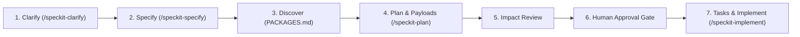

# Network Automation with Python Code Samples

A collection of Python Code Samples for Network Management across Cisco technologies (RESTCONF, NETCONF, Cisco IOS-XE, Cisco NSO, Netmiko, SNMP, EEM, APIC-EM, and Cisco ACI). 

Includes samples that leverage on-box libraries (Guest Shell / EEM), external APIs (NETCONF/RESTCONF, SNMP, SSH, REST), and centralized controllers.

> 📖 **Comprehensive Package Catalog**: See [PACKAGES.md](./PACKAGES.md) for detailed architectural documentation, YANG data models, input parameters, and execution instructions for all 20 packages and the Cisco NSO automation framework.

---

## Spec-Driven Development (SDD) Workflow

This repository is configured for **Spec-Driven Development (SDD)** using **GitHub Spec Kit** with multi-agent integrations for **Antigravity (`agy`)** and **Claude Code (`claude`)**.

Whenever code changes, bug fixes, or new automation scenarios are introduced, engineers and coding agents follow this required repository workflow:

1. **Clarify Requirements**: Understand user intent and ask up to 5 clarification questions (`/speckit-clarify`).
2. **Structure Specification**: Define requirements and strict acceptance criteria (`/speckit-specify` -> `spec.md`).
3. **Codebase Discovery & Analysis**: Consult [PACKAGES.md](./PACKAGES.md) to discover affected modules, YANG models, and device targets (`/speckit-analyze`).
4. **Planning & Test Payload Generation**: Formulate `plan.md` via `/speckit-plan`, detailing code diffs, offline mock testing strategy, and generated network test payloads (RESTCONF JSON, NETCONF XML, or CLI commands).
5. **Impact Review & Checkpoint**: Verify touched files, blast radius, and rollback capabilities.
6. **Human Approval Gate (Mandatory)**: Human engineer reviews and approves the plan, test payloads, and safety guards before code execution.
7. **Task Decomposition & Implementation**: Deconstruct into tasks (`/speckit-tasks`) and execute against tests (`/speckit-implement`, `/speckit-converge`).

- **Core Constitution**: [`.specify/memory/constitution.md`](.specify/memory/constitution.md)
- **Agent Guidelines**: [`AGENTS.md`](./AGENTS.md) / [`agent.md`](./agent.md)
- **Workflow Skill**: `/speckit-network-workflow`

---

## On-Box Examples (Guest Shell & EEM)

Many Cisco switches and routers provide an on-box Python Interpreter within Guest Shell that can be leveraged to execute scripts directly on end devices.

| Code Sample | Description |
| --- | --- |
| [Execute CLI via Python](/Py-sho-ver-onbox) | Executes `show version` on-box using the Cisco Python `cli` library. |
| [TDR Test Every Interface](/tdr-test) | Runs Time Domain Reflectometry cable diagnostics on all active interfaces to detect physical faults. |
| [EEM Config Changes to Spark](/eem_configdiff_to_spark) | EEM monitors for configuration changes (`%SYS-5-CONFIG_I`) and posts the diff to Cisco Webex/Spark. |
| [Python with Eventing Example](/EEM-interface-move-routes) | EEM dynamically updates static routes when an interface state degrades. |
| [EEM + Python + Spark ChatOps](/spark_checkin) | Sends operational alerts and change check-ins to Webex Teams. |
| [EEM + Python + Email Alert](/PortFlap_email_alert) | Monitors for interface flapping (>5 in 5m), disables the port (`shutdown`), and sends an SMTP alert. |

---

## Off-Box Examples (Model-Driven & Controller APIs)

Python scripts interacting with network elements and controllers via standard interfaces (NETCONF, RESTCONF, SNMP, SSH).

| Code Sample | Description |
| --- | --- |
| [RESTCONF](/RESTCONF) | Complete RESTCONF CRUD operations (`GET`, `POST`, `PUT`, `PATCH`, `DELETE`) supporting IOS-XE and Cisco NSO. |
| [Basic RESTCONF Get](/RC-get-config) | Minimalist RESTCONF script to fetch device running config in JSON format. |
| [Hardware Serial Numbers via RESTCONF](/RC-get-serial-numbers) | Retrieves device chassis and module serial numbers from operational YANG models. |
| [Configure Interface IP with RESTCONF](/restconf_update_ipaddress) | Interactive CLI script to update interface IP address using `ietf-interfaces`. |
| [Basic NETCONF Get](/NC-get-config) | Basic `ncclient` example to `<get-config>` running configuration in XML. |
| [Basic NETCONF Edit](/NC-edit-config) | Transactional `<edit-config>` RPC to update device hostname. |
| [NETCONF XPATH Example](/NC-get-config-xpath) | Server-side XPATH filtering (`/native/interface/Loopback`) for bandwidth-efficient retrieval. |
| [NETCONF Physical Entity](/netconf_entity) | Retrieves RFC 6933 / ENTITY-MIB physical hardware inventory over NETCONF. |
| [Model-Based AAA & NACM](/model-based-aaa) | Role-Based Access Control using `ietf-netconf-acm` (RFC 8341) on Cisco IOS-XE. |
| [Netmiko Interface Management](/netmiko-interface-example) | Multi-vendor CLI automation over SSH for retrieving, creating, and deleting Loopbacks. |
| [SNMP Entity MIB Walk](/snmp_entity) | MIB walk against physical entities using `netsnmp` Python bindings. |
| [Get Host List from APIC-EM](/apic-em_get_hosts) | Queries Cisco APIC-EM REST API (`/api/v1/host`) for connected client IP and MAC mappings. |
| [Get Inventory Stats from APIC-EM](/apic-em_get_inventory_stats) | Fetches complete network device inventory and hardware lifecycle statistics. |
| [Retrieve Tenants from ACI APIC](/acitoolkit_show_tenants) | Queries Cisco ACI fabric for active Tenants, Application Profiles, and EPGs via `acitoolkit`. |

---

## Centralized Cisco NSO Automation Engine

The root directory contains an enterprise-grade automation framework targeting **Cisco Network Services Orchestrator (NSO / NCS)** via RESTCONF:

- [`nso_client.py`](./nso_client.py): Reusable RESTCONF client for device discovery, interface lifecycle, check-sync, and rollback.
- [`nso_scenarios.py`](./nso_scenarios.py): 8 automated scenarios covering fleet discovery, intent verification, and compliance checks.
- [`main.py`](./main.py): Interactive terminal runner for network engineers.
- [`tests/test_nso.py`](./tests/test_nso.py): Automated test suite.
- [`VODAFONE_PRESENTATION_WORKFLOW_AND_SCRIPT.md`](./VODAFONE_PRESENTATION_WORKFLOW_AND_SCRIPT.md): Complete demonstration and presentation runbook.
