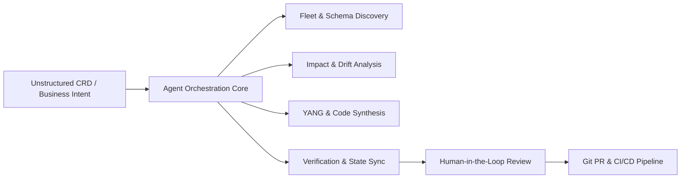
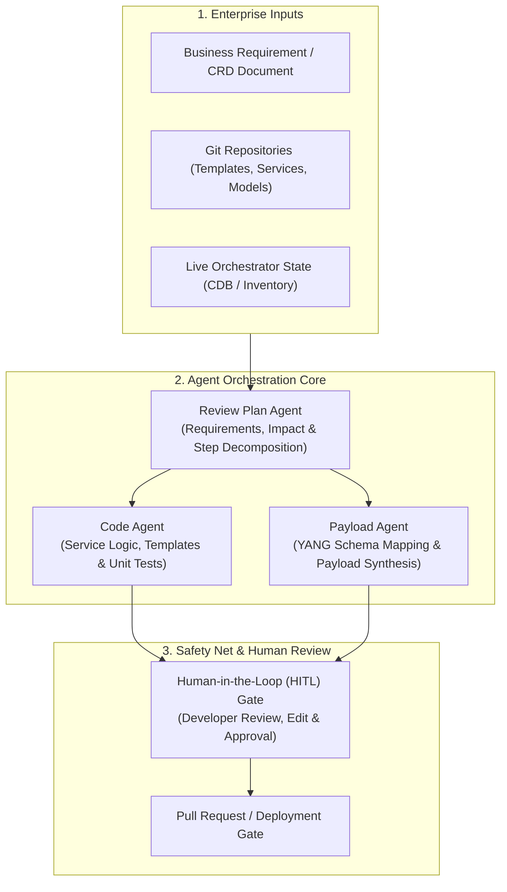
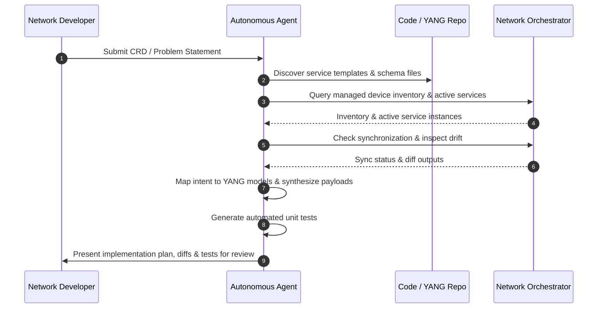
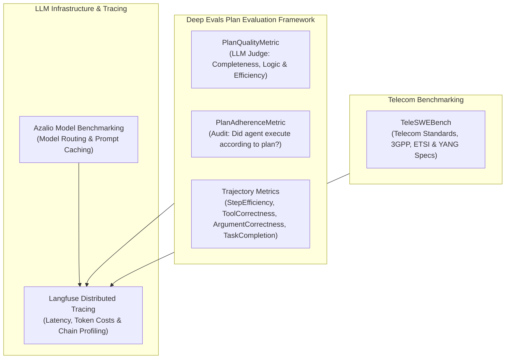

# Vodafone Enterprise Technical Walkthrough & Presentation Plan
## Translating Enterprise CRDs into Actionable Orchestration Plans with Agentic AI

---

## 1. Agent Features & Autonomous Capabilities

Our agentic framework autonomously transforms unstructured customer requirements, business specifications, and Change Request Documents (CRDs) into structured, validated network implementation plans and orchestration artifacts.

### Features Available in Our Agent

| Agent Capability | What Our Agent Performs | Enterprise Value for Vodafone |
| :--- | :--- | :--- |
| **Multi-Device Fleet & Topology Discovery** | Our agent connects to network orchestrators, inspects managed device inventories, and queries provisioned service instances across heterogeneous tiers (core routers, distribution routers, switches, and firewalls). | Automatically determines target hardware platforms, Network Element Drivers (NEDs), and active service domains without manual asset mapping. |
| **Dynamic Schema Grounding & YANG Model Mapping** | Our agent inspects device schemas, standard YANG models, and vendor-specific extensions (such as Cisco IOS, IOS-XR, and NX-OS models) to map abstract service intent to precise configuration paths. | Eliminates manual translation errors between high-level customer requirements and underlying data models. |
| **Autonomous Transactional Payload Synthesis** | Our agent dynamically composes well-formed, typed RESTCONF and NETCONF payloads, validating parameters against required schema definitions. | Accelerates service provisioning and template modification with strict data typing. |
| **In-Band Verification & Out-of-Band Drift Analysis** | Our agent triggers device synchronization checks (`check-sync`) and performs configuration comparisons (`compare-config`) to identify uncommitted changes or out-of-band network drift. | Detects discrepancies before service application, safeguarding network integrity and preventing service disruption. |
| **Full Lifecycle Management & Idempotent Cleanup** | Our agent executes modification, deletion, and teardown operations, validating removal and confirming that system state returns to synchronized baselines. | Ensures configuration hygiene, repeatable rollbacks, and idempotent changes. |
| **Automated Unit Test Synthesis** | Our agent generates dedicated unit and integration tests to validate generated network plans and payload executions against expected device behavior. | Automatically establishes continuous regression suites for every planned change. |

---

## 2. Phase 1: Strategic Alignment & Enterprise Orchestration Context

In this phase, we discuss the overarching enterprise orchestration landscape, the challenges associated with the manual CRD lifecycle, and how our agentic solution integrates with Vodafone's existing tooling.

### Key Discussion Pointers:
- **The CRD Translation Chasm:** Enterprise service delivery currently suffers from an engineering bottleneck between business intent formulation and technical implementation. Translating complex CRDs into orchestrator-ready service templates, YANG definitions, and test procedures typically takes days to weeks of manual developer effort.
- **Complementing Vodafone’s Existing Stack:** Our agentic solution does not replace existing orchestrators or business process management engines (such as Cisco NSO, Camunda BPM, or Ansible). Instead, it operates upstream as an intelligent co-developer that ingests CRDs, analyzes existing repositories, models blast radius, and prepares validated service packages and configuration changes.
- **Enterprise Outcomes:**
  - Substantial compression of CRD-to-implementation turnaround time.
  - Elimination of manual schema and syntax transcription errors.
  - Consistent enforcement of enterprise engineering best practices across teams.
  - Automated discovery of network state and pre-existing drift prior to applying changes.

---

## 3. Phase 2: Architecture, Agent Orchestration & Human-in-the-Loop Workflow

In this phase, we outline the internal architecture of our agentic framework, detailing how specialized agents collaborate in an orchestrated loop, leverage context engineering, and incorporate human review gates.

### Specialized Multi-Agent System

Our framework organizes agent capabilities across distinct, specialized agents that collaborate sequentially and iteratively:

1. **Review Plan Agent:**
   - Interprets the business intent and requirements from the CRD.
   - Decomposes high-level requests into ordered, logical implementation milestones.
   - Assesses change blast radius, identifying affected devices, interface roles, and active service templates.
   - Produces a transparent, auditable plan outlining every required modification and validation step.

2. **Code Agent:**
   - Navigates repository codebases, identifying existing service templates, logic scripts, and package structures.
   - Implements required code and template changes to satisfy the new service specifications.
   - Synthesizes automated unit tests to formally verify that the proposed logic satisfies requirement constraints.

3. **Payload Agent:**
   - Grounded specifically in network data modeling (YANG, XML, JSON).
   - Maps requirements to exact container and leaf hierarchies within orchestrator data trees.
   - Constructs and validates transactional payloads for RESTCONF/NETCONF delivery, ensuring adherence to data types, keys, and constraints.

4. **Human-in-the-Loop (HITL) Process:**
   - Autonomous planning and generation always terminate at an interactive human checkpoint.
   - Senior engineers and developers review generated plans, diffs, and payloads.
   - The developer can approve, reject, or request granular adjustments directly, guiding the agent to refine specific parameters before any change is promoted to a Git pull request or CI/CD pipeline.

### Context Engineering
- Our framework avoids overwhelming the LLM with monolithic documentation or multi-thousand-line YANG schemas.
- Using targeted retrieval, schema chunking, and dynamic prompt compression, the agent retrieves only the relevant subtrees, device modules, and service definitions necessary for the current task.
- This ensures high signal-to-noise ratio, reduces processing latency, and eliminates hallucinations.

---

## 4. Phase 3: Problem Statements, Autonomous Workflow & Mock-up Video Walkthrough

In this phase, we address concrete enterprise problem statements at an architectural level, showcase our video recording of the mock-up execution flow, and explain the autonomous progression that occurs when an agent runs.

### Problem Statements & Solution Progression

We frame the demonstration around typical enterprise telco problem statements:

1. **Problem Statement A: New Enterprise L3VPN Service Addition**
   - *Requirement:* Onboard an enterprise customer requiring dual-homed BGP connectivity across distribution routers, customized MTU, and specific route-target communities.
   - *Autonomous Solution:* The agent inspects existing L3VPN templates, identifies the required service parameters, constructs the service instance payload, runs a sync-check on target PEs, and drafts the implementation plan.

2. **Problem Statement B: Interface Configuration & Attribute Modification**
   - *Requirement:* Standardize loopback and management interfaces across regional distribution devices, enforcing new IP addressing schemes and descriptive metadata.
   - *Autonomous Solution:* The agent identifies affected interfaces, formulates atomic RESTCONF updates, checks for out-of-band discrepancies, and compiles verified unit tests.

3. **Problem Statement C: Detecting & Reconciling Network Configuration Drift**
   - *Requirement:* Ensure pre-existing out-of-band configuration changes on core routers do not conflict with scheduled service deployments.
   - *Autonomous Solution:* The agent performs automated configuration comparisons against the orchestrator's database, flags conflicting changes in the implementation plan, and prompts the engineer for reconciliation guidance.

### Video Recording of Execution Flow
- We present a clear, pre-recorded video demonstrating the execution flow on an enterprise carrier environment.
- Showcases the end-to-end user experience: requirement input, intermediate agent reasoning and schema queries, plan generation, and developer interaction.
- All sensitive customer identifiers, IP addresses, and topology hostnames are appropriately masked.

### What Happens Autonomously When an Agent Executes

When an agent is initiated on a task, it executes the following sequence autonomously:

- **Topology & Fleet Inspection:** The agent connects to the orchestration layer to inspect live inventory, active service packages, and managed device types.
- **Schema Grounding & Validation:** The agent searches the codebase, resolves YANG namespaces, and validates that proposed data fields conform to orchestrator requirements.
- **Workflow Point Simulation:** The agent simulates proposed configuration changes against orchestrator operational RPCs, confirming syntax and transactional feasibility.
- **Drift & State Auditing:** The agent automatically runs sync and comparison checks on target nodes to detect uncommitted changes or out-of-band drifts before finalizing plans.
- **Automated Unit Test Synthesis:** The agent writes unit and integration tests to establish a repeatable verification baseline for the change.

---

## 5. Phase 4: Plan Correctness, Deep Evaluation & Infrastructure Benchmarking

In this phase, we address how plan correctness is verified, how accuracy and adherence are measured, and how our underlying LLM infrastructure is benchmarked and optimized.

### Deep Plan Evaluation Methodology

To guarantee that generated implementation plans are logical, complete, and reliable, our evaluation framework employs structured, multi-dimensional metrics:

- **`PlanQualityMetric`:**
  - Uses an LLM judge to evaluate the agent’s generated plan against the original CRD.
  - Scores the plan on **completeness** (did it address all requirements?), **logic** (are dependent steps sequenced properly?), and **efficiency** (does it avoid redundant or conflicting changes?).
- **`PlanAdherenceMetric`:**
  - Evaluates whether the agent strictly adhered to its own formulated plan during execution.
  - Crucial in telecom engineering: a good plan is useless if the agent deviates or introduces unsanctioned operations during tool execution.
- **Execution Trajectory Metrics:**
  - **`StepEfficiency`:** Measures the ratio of required tool invocations to extraneous exploratory actions.
  - **`ToolCorrectness`:** Asserts that the agent invoked the appropriate operational methods (e.g., proper RESTCONF HTTP methods and RPC endpoints).
  - **`ArgumentCorrectness`:** Validates that parameters (IP addresses, netmasks, interface identifiers, YANG keys) conform exactly to schema requirements.
  - **`TaskCompletion`:** Evaluates whether the end goal defined in the requirement document was satisfied.

### Domain Benchmarking with TeleSWEBench
- Standard general-purpose software engineering benchmarks fail to evaluate telecom domain specificities.
- We benchmark our models using **`TeleSWEBench`**, focusing on telecom standards, 3GPP and ETSI specifications, and standard IETF/OpenConfig/vendor YANG models.
- This ensures that our agents are assessed on real networking patterns rather than generic code synthesis.

### Langfuse Tracing & LLM Infrastructure Optimization
- **Langfuse-Based Evaluation & Tracing:**
  - Every step, reasoning chain, prompt variation, and tool invocation is recorded as a distributed trace.
  - Provides visibility into token utilization, latency per turn, and error recovery behavior.
- **Azalio Model Benchmarking & Optimization:**
  - **Intelligent Model Routing:** Leverages lighter, high-throughput models for deterministic tasks (schema lookups, syntax checks) and larger frontier models for multi-step architectural planning and impact analysis.
  - **Prompt Caching & Structured Output Enforcement:** Enforces strict output schemas to minimize parsing retries, optimize response times, and reduce infrastructure overhead.
- **Improvement Roadmap:**
  - Continuous expansion of our synthetic enterprise CRD test library.
  - Refinement of specialized agent prompts based on telemetry insights.
  - Ongoing alignment of model adapters with emerging telecom standards.

---

## 6. Business Value, Enterprise Synergy & PoC Framework

### Complementation with Vodafone’s Operating Model

Our agentic framework acts as an acceleration layer for Vodafone’s existing automation investments:

- **Empowering Developers:** Eliminates tedious manual boilerplate, allowing senior architects and developers to focus on architecture, complex service policies, and final approvals.
- **Reduced Turnaround Time:** Transforms multi-day CRD review and template coding cycles into rapid, assisted turnarounds.
- **Consistency & Governance:** Standardizes how requirements are mapped to YANG configurations across diverse engineering teams.
- **Pre-Flight Safety:** Enforces automatic sync and drift verification before any plan is approved for deployment.

### Focused Proof of Concept (PoC) Framework

We propose validating these capabilities through a focused, structured engagement:

1. **Scope Definition:** Select 2–4 representative Vodafone enterprise service CRDs (e.g., L3VPN onboarding, QoS policy updates, or interface management).
2. **Environment Integration:** Ingest relevant Vodafone service templates, schema definitions, and sample repository structures.
3. **Evaluation & Execution:** Run the multi-agent framework across the agreed problem statements, evaluating outcomes via Langfuse and the Deep Evals metrics.
4. **Outcome Review:** Assess developer experience, turnaround time reduction, plan completeness, and plan adherence with Vodafone’s Enterprise team.
